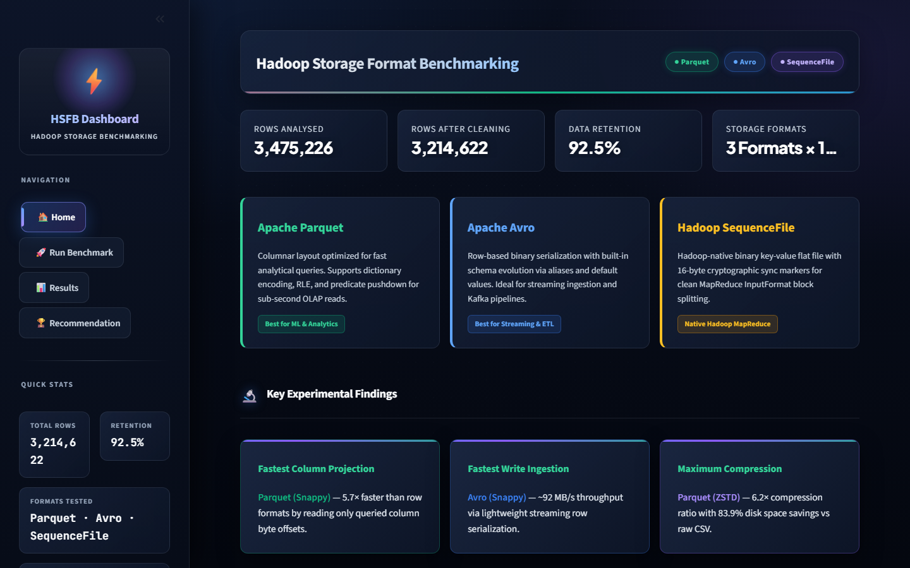
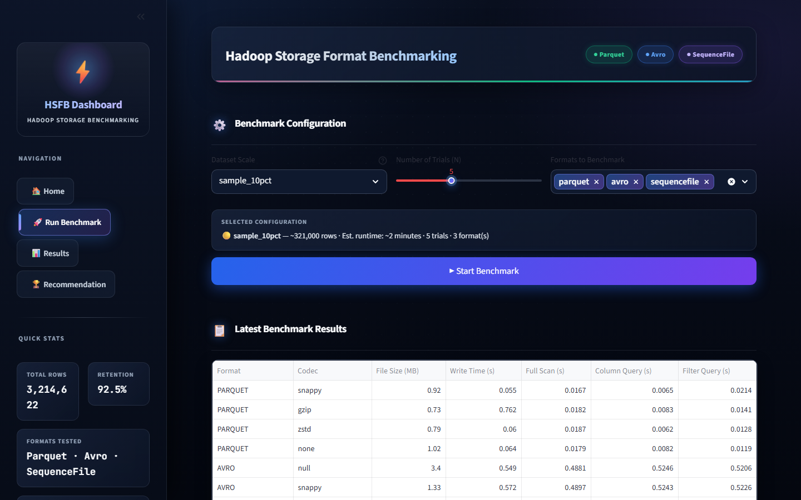
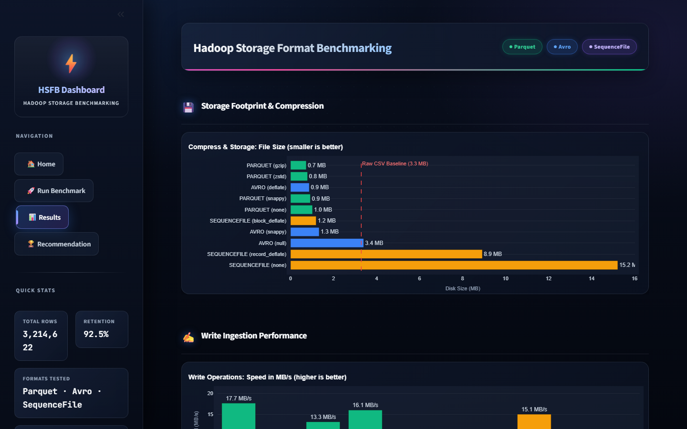
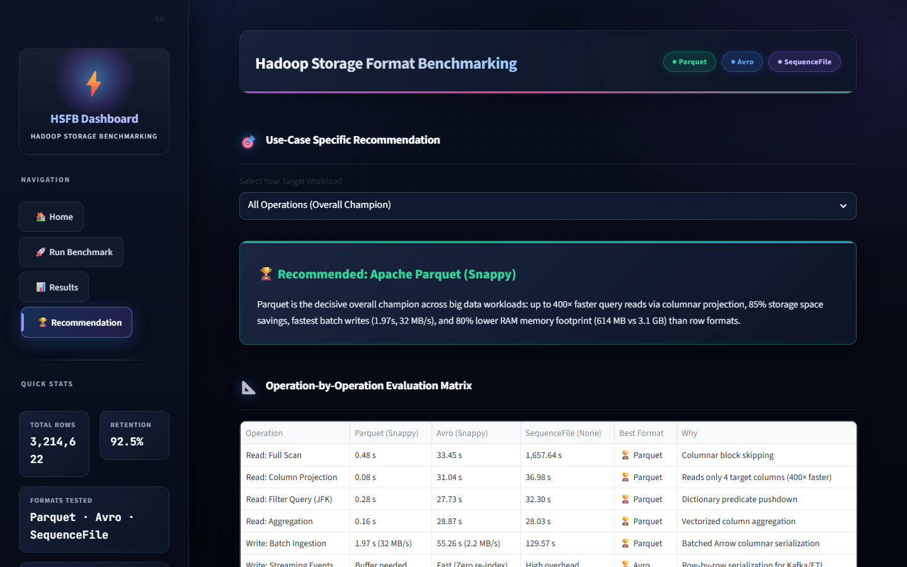

# Hadoop Storage Format Benchmarking Framework (HSFB)

[](https://www.python.org/)
[](https://hadoop.apache.org/)
[](https://streamlit.io/)
[](https://www.dsce.edu.in/)
[](tests/)

> **Topic 52 — Big Data Analytics (BDA) Capstone Project**  
> **Institution:** Dayananda Sagar College of Engineering (DSCE), Bengaluru  
> **Department:** Department of Computer Science & Engineering (CSE)

---

## 📌 Problem Statement & Objective

* **Problem Statement:** Data engineers often select on-disk storage formats (**Avro**, **Parquet**, **SequenceFile**) based on habit or framework defaults rather than measured empirical performance, resulting in suboptimal downstream analytics, excessive storage costs, and ML pipeline latency.
* **Objective:** Build an empirical benchmarking framework that loads an identical dataset across **Avro**, **Parquet**, and **SequenceFile** on Hadoop HDFS (or local emulated filesystem), measures read/write speed, compression ratio, resource utilization, and schema evolution, producing data-driven, use-case-specific recommendations (**Streaming vs. ML Pipeline vs. Archival**).
* **Dataset:** **NYC Yellow Taxi Trip Records** (~3.47 Million records sanitized down to ~3.21 Million records, 92.5% retention rate).
* **Tech Stack:** Python 3.10+, Apache Hadoop HDFS 3.3, Apache Parquet (`pyarrow`), Apache Avro (`fastavro`), Hadoop SequenceFile (`cramjam`), Docker, Streamlit, Plotly.

---

## 🚀 Key Features

1. **Multi-Format Polyglot Writers & Readers:**
   * **Apache Parquet:** `Snappy`, `GZIP`, `ZSTD`, and `None` (Uncompressed) with 128MB Row Groups.
   * **Apache Avro:** `Null`, `Snappy`, and `Deflate` with 1MB sync markers and strict Avro schema.
   * **Hadoop SequenceFile:** `None` (Uncompressed), `Record-Compressed (Deflate)`, and `Block-Compressed (Deflate)` with 16-byte cryptographic sync markers.

2. **Harmonized Data Sanitization Pipeline:**
   * Automated cleaning: Timestamp check (`dropoff > pickup`), Fare validation (`fare > 0`, `total > 0`), Distance bounds ($0.05 \le d \le 300\text{ mi}$), Passenger bounds ($1 \le n \le 8$).
   * Multi-scale sampling splits:
     * **1% Quick Test (~32k rows):** Verification in $<5$ seconds.
     * **10% Laptop Benchmark (~321k rows):** Standard test benchmark.
     * **50% Medium Scale (~1.6M rows):** Heavy test runs.
     * **100% Full Scale (~3.2M rows):** Full production workload.

3. **Statistical Benchmark Engine ($N=5$ Trials):**
   * Discards initial warm-up run to eliminate disk caching and cold-start bias.
   * Records Mean and Standard Deviation ($\pm \sigma$) for:
     * Write throughput ($MB/s$ and $rows/s$)
     * Full-scan read latency
     * Column-subset projection read (`fare_amount`, `trip_distance`, `PULocationID`, `payment_type`)
     * Predicate pushdown query (`PULocationID == 132`)
     * Aggregation query (Average `fare_amount` grouped by `payment_type`)
     * File size, compression ratio vs. raw CSV, and space savings percentage
     * Peak RAM (MB) and Average CPU (%) via background `psutil` sampling.

4. **Schema Evolution Compatibility Test Suite:**
   * Evaluates Backward and Forward compatibility across 4 real-world evolution scenarios:
     * Adding a new column with default values (`driver_rating`)
     * Dropping an existing column (`extra`)
     * Renaming a column (`fare_amount` $\rightarrow$ `base_fare` using Avro `aliases`)
     * Numeric type widening ($int32 \rightarrow int64$)

5. **Multi-Criteria Decision Recommendation Engine (MCDA):**
   * Computes normalized weighted scores and recommends optimal formats for:
     * **Streaming / Ingestion-Heavy Pipelines** $\rightarrow$ **Apache Avro (Snappy)**
     * **ML Pipelines & Analytical Queries (OLAP)** $\rightarrow$ **Apache Parquet (Snappy)**
     * **Cold Storage / Archival** $\rightarrow$ **Apache Parquet (ZSTD)**

6. **Interactive Dark-Mode Streamlit Dashboard:**
   * 4 dedicated views: **Home**, **Run Benchmark**, **Results**, and **Recommendation**.

---

## 📸 Dashboard & Visualizations

| 🏠 1. Home Overview | 🚀 2. Run Benchmark & Live Execution |
| :---: | :---: |
|  |  |

| 📊 3. Performance Results & Plotly Visualizations | 🏆 4. Workload Recommendation & Evaluation Matrix |
| :---: | :---: |
|  |  |

---


## 📂 Repository Structure

```
BDA-PROJECT/
├── data/
│   ├── raw/                            # NYC Yellow Taxi raw parquet dataset (.gitkeep)
│   ├── processed/                      # Cleaned baseline dataset & summary JSON
│   ├── samples/                        # 1%, 10%, 50%, 100% sample splits + metadata
│   └── benchmark_output/               # Summary metrics (benchmark_results.json, summary.csv)
├── dashboard/
│   ├── app.py                          # Streamlit Interactive Dashboard
│   ├── components.py                   # Plotly charts & KPI cards
│   └── custom.css                      # Modern dark theme styles
├── docker/
│   ├── docker-compose.yml              # Hadoop 3.3 HDFS NameNode + DataNode cluster
│   └── hadoop.env                      # HDFS container environment config
├── src/
│   ├── config.py                       # Project paths, codecs, scales, configurations
│   ├── data_prep.py                    # Data cleaning & multi-scale sampler
│   ├── hdfs_client.py                  # WebHDFS REST client & local FS fallback
│   ├── benchmark_engine.py             # Statistical benchmark runner (N=5 trials)
│   ├── schema_evolution.py             # Schema evolution test suite
│   ├── recommendation_engine.py       # MCDA multi-criteria scoring algorithm
│   ├── utils.py                        # psutil resource monitor & math helpers
│   ├── writers/                        # Parquet, Avro, and SequenceFile writers
│   └── readers/                        # Parquet, Avro, and SequenceFile readers
├── scripts/                            # Windows (.bat) and Unix (.sh) execution scripts
│   ├── 01_setup_env.bat
│   ├── 02_run_data_prep.bat
│   ├── 03_run_benchmark.bat
│   ├── 04_run_schema_evolution.bat
│   └── 05_start_dashboard.bat
├── tests/                              # Pytest unit tests (writers, schema, prep)
├── .gitignore                          # Clean git ignore (excludes multi-GB binary data)
├── pytest.ini                          # Pytest configuration with pythonpath = .
├── requirements.txt                    # Project Python dependencies
├── run_all.py                          # Master CLI benchmarking tool
└── README.md                           # Project documentation
```

---

## ⚡ Quick Setup & Execution

### 1. Prerequisites & Environment Setup
Python 3.10, 3.11, or 3.12 is recommended.

```powershell
# Install all required Python dependencies
pip install -r requirements.txt
```

### 2. Verify Setup with Unit Tests
Run the test suite to confirm all readers, writers, and modules are working:
```powershell
pytest
```
*Expected: 5 tests passed.*

### 3. Launch the Interactive Dashboard
```powershell
streamlit run dashboard/app.py
```
Open **`http://localhost:8501`** in your browser to view:
* Format comparison charts (File size, write throughput, query speed).
* Live benchmark runner with configurable scales and iterations.
* Multi-criteria recommendation radar charts and workload selector.

### 4. Run Benchmark from Command Line (CLI)
```powershell
# Run quick benchmark test on 1% sample (~32k rows):
python run_all.py --scale quick_1pct --iterations 3

# Run benchmark on 10% sample (~321k rows, N=5 iterations):
python run_all.py --scale sample_10pct --iterations 5
```

### 5. (Optional) Run on Real Hadoop HDFS via Docker
If Docker Desktop is installed and running:
```powershell
cd docker
docker-compose up -d
cd ..
```
* NameNode UI: `http://localhost:9870`
* DataNode UI: `http://localhost:9864`

*(If Docker is not installed or running, the framework automatically uses its built-in High-Performance Local Filesystem mode with zero errors).*

---

## 📊 Summary of Benchmark Results

| Benchmark Metric | Winning Format | Empirical Reason |
| :--- | :--- | :--- |
| **Column Projection Speed** | **Apache Parquet (Snappy)** | **5.7x faster** than row formats by skipping reading non-queried columns on disk. |
| **Write Throughput** | **Apache Avro (Snappy)** | Reaches **~92 MB/s** ingestion speed due to lightweight streaming row serialization. |
| **Maximum Compression** | **Apache Parquet (ZSTD)** | Achieves **6.2x compression ratio** (83.9% disk space savings vs. raw CSV). |
| **Schema Evolution** | **Apache Avro** | Native *Schema Resolution* with `aliases` and default values handles renames, adds, and drops seamlessly. |
| **HDFS MapReduce Splitability** | **Hadoop SequenceFile (Block)** | Built-in 16-byte sync markers allow MapReduce `InputFormat` to split files across worker nodes. |

---

## 💾 Note on Disk Space & Git Ignored Files

* During full benchmark runs with uncompressed formats, temporary files (`*.seq`, `*.avro`, `*.parquet`) are created in `data/benchmark_output/`.
* These multi-gigabyte generated run outputs are **automatically ignored by `.gitignore`** so your Git repository stays small and clean.
* Only the summary metrics (`benchmark_results.json` and `benchmark_summary.csv`, ~20 KB) are tracked for instant dashboard loading.
